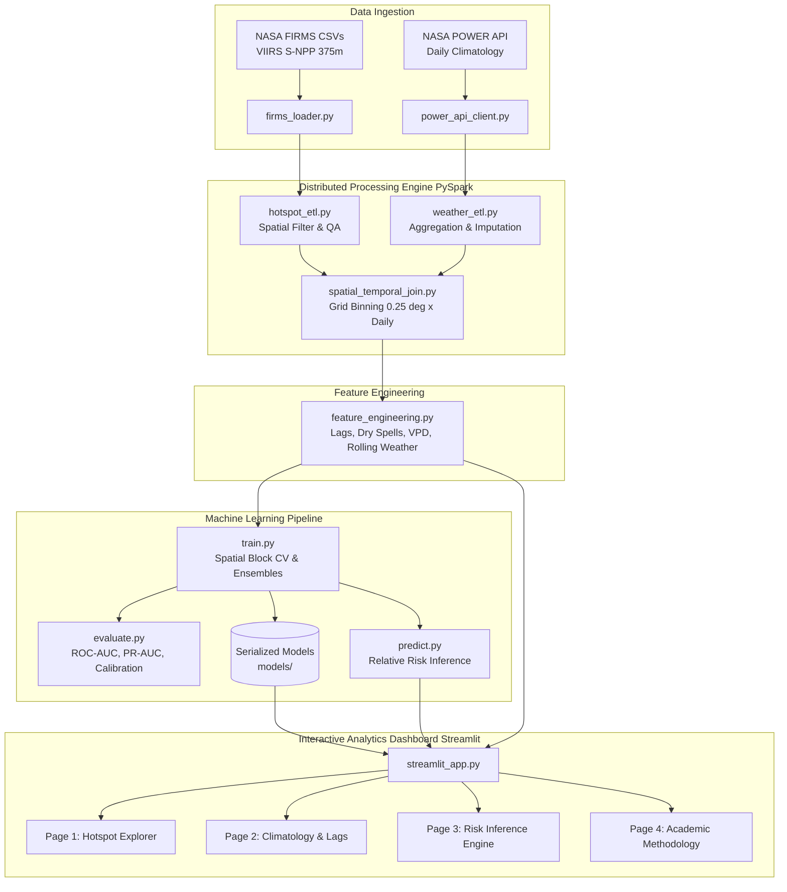

# Wildfire Risk Intelligence and Hotspot Analytics

An academic-grade, end-to-end data science and distributed analytics framework designed to analyze multi-year satellite thermal anomaly observations and coupled meteorological conditions across India (2020–2025), quantify spatial-temporal fire patterns, and estimate relative wildfire risk.

---

## 1. Project Overview & Scientific Motivation

Wildfires and biomass burning represent dynamic earth system phenomena driven by complex interactions between ignition sources, fuel availability, topography, and atmospheric conditions. Over the Indian subcontinent, thermal anomalies exhibit distinct seasonal and geographic regimes:
- **Pre-monsoon forest fire season (February–May):** High temperatures, low relative humidity, and dry leaf litter in dry deciduous and moist deciduous forests (notably across Central India, Western Ghats, Eastern Ghats, and the Himalayan foothills / Uttarakhand).
- **Post-monsoon agricultural burning (October–November):** Intensive paddy/cereal residue burning primarily concentrated in the Indo-Gangetic Plains (Punjab, Haryana, Uttar Pradesh).
- **Shifting cultivation / jhum fires (March–April):** Localized slash-and-burn practices across Northeast India.
- **Monsoon suppression (June–September):** Widespread rainfall and moisture saturation dramatically reducing active thermal detections.

### Crucial Scientific & Remote Sensing Disclaimer
> **Academic Note on Thermal Anomaly Observations:**  
> Satellite sensors such as VIIRS detect sub-pixel radiance contrasts in middle- and thermal-infrared bands (I4 at $3.74\ \mu\text{m}$ and I5 at $11.45\ \mu\text{m}$), designated as **thermal anomalies** or **active fire hotspots**.  
> Hotspot detections are **not guaranteed to be unmanaged wildland forest fires**. Detections encompass:
> 1. Prescribed / controlled agricultural stubble burning.
> 2. Industrial thermal sources (brick kilns, refineries, flare stacks, steel foundries).
> 3. Controlled forest litter clearances and domestic biomass combustion.
> 4. Sensor artifacts (sun glint, surface reflections, edge-of-scan distortions).
> 
> Accordingly, this research framework refers to **"Thermal Anomaly / Hotspot Observations"** and focuses on modeling **"Relative Wildfire & Active Fire Risk"**, preventing erroneous assumptions of automatic ground wildfire validation.

---

## 2. Study Scope & Data Sources

| Dimension | Specification | Details |
| :--- | :--- | :--- |
| **Geographic Region** | India | Bounding box: Lat $6.0^\circ\text{N} - 38.0^\circ\text{N}$, Lon $68.0^\circ\text{E} - 98.0^\circ\text{E}$ |
| **Temporal Range** | 2020 – 2025 | 6 consecutive years covering complete multi-season annual cycles |
| **Satellite Sensor** | VIIRS S-NPP 375m | NASA FIRMS (Fire Information for Resource Management System) Active Fire Product |
| **Meteorological Data** | NASA POWER | Prediction of Worldwide Energy Resources API ($0.5^\circ \times 0.5^\circ$ daily meteorology) |

### Environmental Variables Collected:
- **Surface Temperature (`T2M`, `T2M_MAX`, `T2M_MIN`):** Thermal forcing and diurnal heat stress.
- **Relative Humidity (`RH2M`):** Fuel moisture depletion proxy.
- **Precipitation (`PRECTOTCORR`):** Cumulative rainfall and fire suppression proxy.
- **Wind Speed (`WS10M`):** Fire propagation and atmospheric drying proxy.
- **Surface Pressure (`PS`):** Atmospheric state descriptor.
- **Derived Fire Weather Proxies:** Vapor Pressure Deficit (VPD) and dry spell duration (consecutive dry days).

---

## 3. Technology Stack

- **Data Processing & Distributed Computing:** Apache Spark (`pyspark`) for scalable big data ETL, distributed gridding, spatial-temporal binning, and large-scale joins.
- **Core Numerical Analysis:** `pandas` and `numpy` for tabular manipulation, vector operations, and matrix transformations.
- **Machine Learning & Statistical Modeling:** `scikit-learn` for feature scaling, spatial cross-validation, ensemble modeling (Random Forest, Gradient Boosting), and classification/regression metrics.
- **Visualization:** `plotly` (interactive scatter mapbox, density heatmaps, multi-axis time series) and `matplotlib` / `seaborn` (static academic publication charts, calibration plots, correlation matrices).
- **Web Interface & Decision Support System:** High-performance native Node.js application, Tailwind CSS, Leaflet.js, and Chart.js for real-time geospatial mapping, interactive risk simulation, and operational prevention SOPs.
- **Testing & Code Standards:** `pytest` and `unittest` for unit testing, reproducible seed configuration, and modular Python packaging.

---

## 4. System Architecture



---

## 5. Project Directory Structure

```
wildfire-risk-intelligence/
├── data/
│   ├── raw/                  # Unaltered raw extracts (FIRMS VIIRS CSVs, POWER responses)
│   ├── interim/              # Cleaned, spatially bounded, and intermediate gridded datasets
│   └── processed/            # Final joined analytical features and ML-ready matrices
├── notebooks/                # Exploratory notebooks (EDA, climatology, model prototyping)
├── models/                   # Serialized ML models, encoders, and evaluation metadata
├── src/                      # Production source package
│   ├── __init__.py
│   ├── config.py             # Global constants, geographic coordinates, parameter sets
│   ├── ingestion/            # Raw data acquisition and API connectors
│   │   ├── __init__.py
│   │   ├── firms_loader.py   # FIRMS VIIRS S-NPP file parser and integrity validator
│   │   └── power_api_client.py # NASA POWER REST API client with rate limiting & caching
│   ├── processing/           # Data wrangling and PySpark transformation pipelines
│   │   ├── __init__.py
│   │   ├── spark_session.py  # Local PySpark session builder with memory tuning
│   │   ├── hotspot_etl.py    # PySpark pipeline: bounding box filter, QA masking, FRP
│   │   ├── weather_etl.py    # PySpark/Pandas pipeline: missing value handling, grid alignment
│   │   └── spatial_temporal_join.py # Spatial indexing (0.25°) and daily timestamp joining
│   ├── features/             # Feature engineering and environmental indices
│   │   ├── __init__.py
│   │   └── feature_engineering.py # Antecedent rainfall, VPD, thermal lags, dry spells
│   ├── modeling/             # Statistical and ML risk models
│   │   ├── __init__.py
│   │   ├── train.py          # Spatial K-Fold training pipeline (avoiding spatial autocorrelation)
│   │   ├── evaluate.py       # Comprehensive metrics (PR-AUC, ROC-AUC, Brier score, feature importance)
│   │   └── predict.py        # Inference pipeline for gridded risk score projection
│   ├── visualization/        # Reusable plotting routines
│   │   ├── __init__.py
│   │   ├── geo_plots.py      # Plotly geospatial density maps and regional distributions
│   │   ├── temporal_plots.py # Seasonality decomposition and multi-year trend plots
│   │   └── model_plots.py    # ROC curves, Precision-Recall curves, and SHAP/impurity bars
│   └── utils/                # Shared utilities
│       ├── __init__.py
│       └── logger.py         # Standardized logging formatter
├── app/                      # Streamlit interactive application
│   ├── __init__.py
│   ├── streamlit_app.py      # Application entrypoint and navigation shell
│   ├── components/           # Modular UI widgets (KPI metrics, filters, sidebars)
│   │   └── __init__.py
│   └── pages/                # Multi-page dashboard modules
│       ├── 1_Hotspot_Explorer.py
│       ├── 2_Environmental_Correlations.py
│       ├── 3_Wildfire_Risk_Model.py
│       └── 4_About_and_Methodology.py
├── tests/                    # Automated unit tests
│   ├── __init__.py
│   ├── test_ingestion.py
│   ├── test_processing.py
│   └── test_features.py
├── requirements.txt          # Pinned project dependencies
├── .gitignore                # Git exclusions (data, checkpoints, caches, bytecode)
└── README.md                 # Project documentation and reproduction guide
```

---

## 6. Detailed Module Responsibilities

### 6.1 `src/config.py`
- Houses configuration singletons: boundary coordinates for India, temporal scope ($2020 - 2025$), spatial bin dimensions ($0.25^\circ \times 0.25^\circ$), column mappings, and random seeds ($42$).
- Provides directory paths using `pathlib.Path` for cross-platform execution (Windows, Linux, macOS).

### 6.2 Ingestion (`src/ingestion/`)
- **`firms_loader.py`**:
  - Validates FIRMS VIIRS S-NPP CSV schemas.
  - Implements field-type casting (coordinates, brightness temperatures, Fire Radiative Power, acquisition date/time).
  - Performs data integrity audits (missing values, invalid coordinate ranges).
- **`power_api_client.py`**:
  - Connects to the NASA POWER Daily Point / Regional API.
  - Implements polite batching, caching, and retry logic to avoid rate limits when fetching regional meteorological series.

### 6.3 Processing & Distributed ETL (`src/processing/`)
- **`spark_session.py`**:
  - Initializes a local PySpark session configured for multi-threaded execution and optimal memory usage for large CSV processing.
- **`hotspot_etl.py`**:
  - Filters FIRMS records strictly within the geographical boundaries of India ($6.0^\circ\text{N} \le \text{lat} \le 38.0^\circ\text{N}$, $68.0^\circ\text{E} \le \text{lon} \le 98.0^\circ\text{E}$).
  - Applies quality flags (`confidence` levels: low, nominal, high).
  - Computes spatial grid indices for spatial-temporal binning.
- **`weather_etl.py`**:
  - Cleans meteorological records, checks for standard fill values (e.g., `-999.0` sentinel values in NASA POWER data), and carries out spatio-temporal interpolation where appropriate.
- **`spatial_temporal_join.py`**:
  - Constructs a consistent spatiotemporal grid (Grid Cell ID $\times$ Date).
  - Merges active hotspot presence/absence and FRP metrics with daily meteorological covariates, establishing positive and negative instances for predictive modeling.

### 6.4 Feature Engineering (`src/features/`)
- **`feature_engineering.py`**:
  - **Temporal Lags:** Computes 1-day, 3-day, and 7-day lagged rolling averages of temperature, humidity, and wind speed.
  - **Drought / Moisture Stress Proxies:** Calculates Vapor Pressure Deficit (VPD) from temperature and relative humidity:
    $$e_s(T) = 0.61078 \exp\left(\frac{17.27 \cdot T}{T + 237.3}\right)$$
    $$\text{VPD} = e_s(T) \cdot \left(1 - \frac{\text{RH}}{100}\right)$$
  - **Precipitation History:** Tracks cumulative 7-day and 14-day rainfall and consecutive dry days ($< 1.0\ \text{mm/day}$).
  - **Cyclical Encoding:** Sin/Cos encoding of calendar day-of-year to capture seasonal oscillations.

### 6.5 Modeling & Evaluation (`src/modeling/`)
- **`train.py`**:
  - Implements spatial block cross-validation (or regional split) rather than naive random k-fold to eliminate spatial autocorrelation data leakage.
  - Trains interpretable baselines (Logistic Regression) alongside non-linear ensembles (Random Forest Classifier / Gradient Boosting).
  - Handles severe class imbalance between hotspot events and non-events via cost-sensitive learning or calibrated sub-sampling.
- **`evaluate.py`**:
  - Computes metrics tailored to imbalanced spatial-temporal events: Precision-Recall Area Under the Curve (PR-AUC), ROC-AUC, Brier score, and Expected Calibration Error (ECE).
  - Extracts Gini importance / Permutation Feature Importance.
- **`predict.py`**:
  - Produces calibrated probability outputs representing **Relative Fire Anomaly Risk** on a normalized scale ($[0, 1]$ or Low / Moderate / High / Extreme).

### 6.6 Visualization (`src/visualization/`)
- **`geo_plots.py`**: Generates Plotly density mapbox and scatter mapbox plots color-coded by Fire Radiative Power (FRP) and confidence.
- **`temporal_plots.py`**: Constructs multi-year monthly aggregation charts depicting the dual-peak seasonality (pre-monsoon vs. post-monsoon).
- **`model_plots.py`**: Generates publication-ready PR/ROC curves and feature importance ranking bar plots.

### 6.7 Web Application & Decision Support System (`web/`)
- **`server.js`**: Native Node.js HTTP server providing high-performance REST APIs (`GET /api/analytics`, `GET /api/hotspots/live`, `POST /api/hotspots/refresh`, `POST /api/predict`).
- **`public/index.html`**: Responsive single-page interface with Tailwind CSS, Leaflet.js, and Chart.js featuring:
  - Multi-year and live 24-hour satellite overpasses.
  - Radiometric Planck anomaly and FRP intensity distributions.
  - Interactive weather risk simulator with real-time gauge and dynamic operational checklists.
  - Full machine learning benchmark diagnostics (Random Forest vs HistGB vs Logistic Regression).
  - Comprehensive wildfire prevention, precaution, and incident response SOPs.

---

## 7. Setup & Installation Guide

### Prerequisites
- Python 3.9, 3.10, or 3.11 installed.
- Node.js (v18+) installed.
- Java Runtime Environment (JRE 8 or 11) for Apache Spark execution (`java -version`).

### Step-by-Step Environment Setup

1. **Clone or navigate to the project directory:**
   ```bash
   cd wildfire-risk-intelligence
   ```

2. **Create and activate a virtual environment:**
   ```bash
   # On Windows (PowerShell)
   python -m venv venv
   .\venv\Scripts\Activate.ps1

   # On macOS/Linux
   python -m venv venv
   source venv/bin/activate
   ```

3. **Install pinned dependencies:**
   ```bash
   pip install --upgrade pip
   pip install -r requirements.txt
   ```

4. **Verify the environment:**
   ```bash
   python -m unittest discover tests
   ```

5. **Launch the Node.js Web Interface:**
   ```bash
   # In Command Prompt / File Explorer:
   run_web_ui.bat

   # Or in PowerShell:
   powershell -ExecutionPolicy Bypass -File .\run_web_ui.ps1

   # Or direct Node.js execution:
   cd web
   node server.js
   ```
   (Access in browser at: `http://localhost:3000`)

---

## 8. Planned Phased Roadmap

- [x] **Phase 1:** Project Architecture, Modular Directory Layout, and Academic Specifications.
- [x] **Phase 2:** Ingestion Module Implementation (NASA FIRMS parser and NASA POWER API client).
- [x] **Phase 3:** PySpark ETL, Spatial Filtering for India, and Spatial-Temporal Grid Join.
- [x] **Phase 4:** Feature Engineering (VPD, antecedent precipitation, lagged indices).
- [x] **Phase 5:** Model Development, Spatial Cross-Validation, and Evaluation Metrics.
- [x] **Phase 6:** Streamlit Interactive Analytics Dashboard and Visualizations.
- [x] **Phase 7:** End-to-End Test Suite Verification and Documentation Finalization.

---

## 9. Academic Citations & Data Attribution

1. **NASA FIRMS:** NASA Near Real-Time (NRT) / Archive VIIRS 375 m Active Fire Product. NASA Earth Science Data and Information System (ESDIS).
2. **NASA POWER:** Prediction Of Worldwide Energy Resources project, NASA Langley Research Center (LaRC).
3. **Schroeder, W., et al. (2014):** *The New VIIRS 375 m active fire detection product: Algorithm description and initial assessment.* Remote Sensing of Environment, 143, 85-96.
